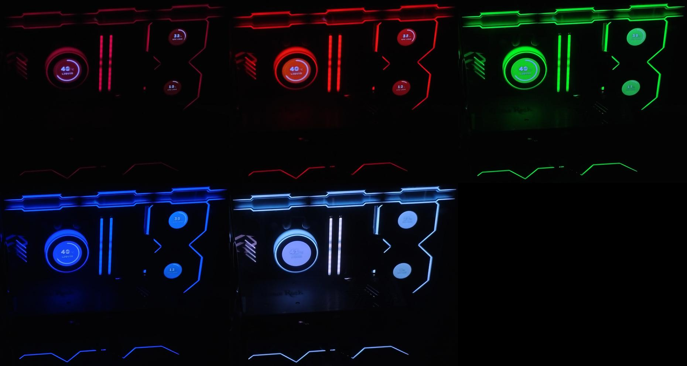
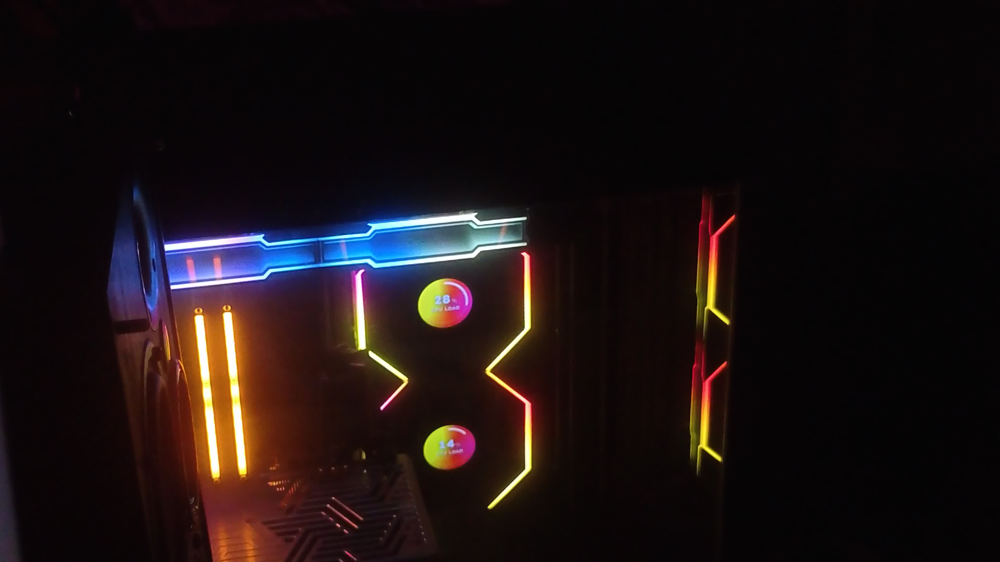
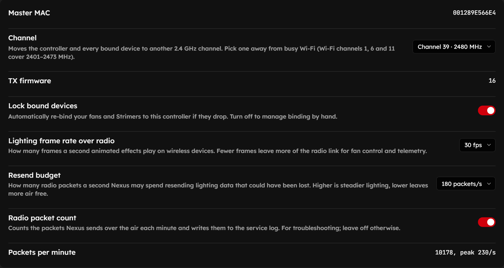
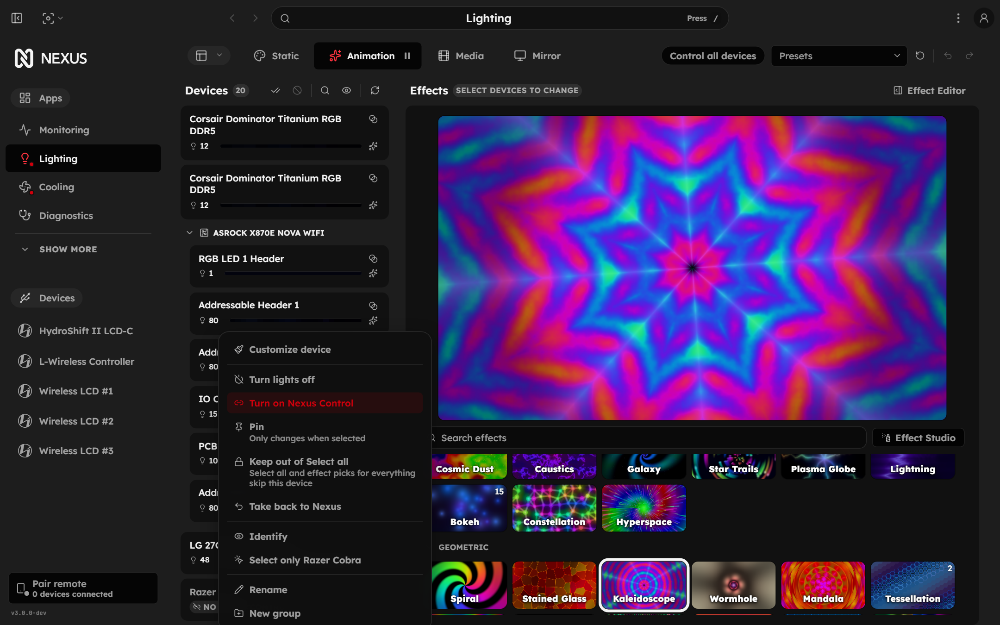
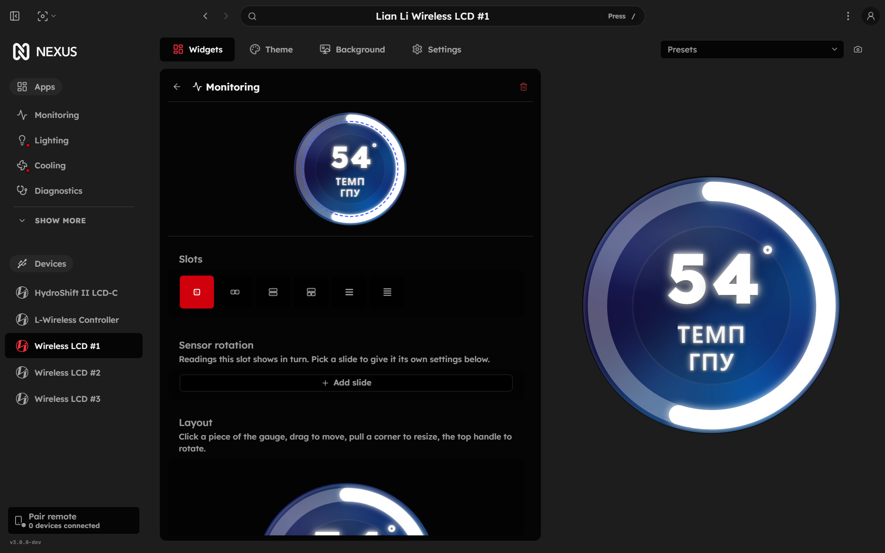
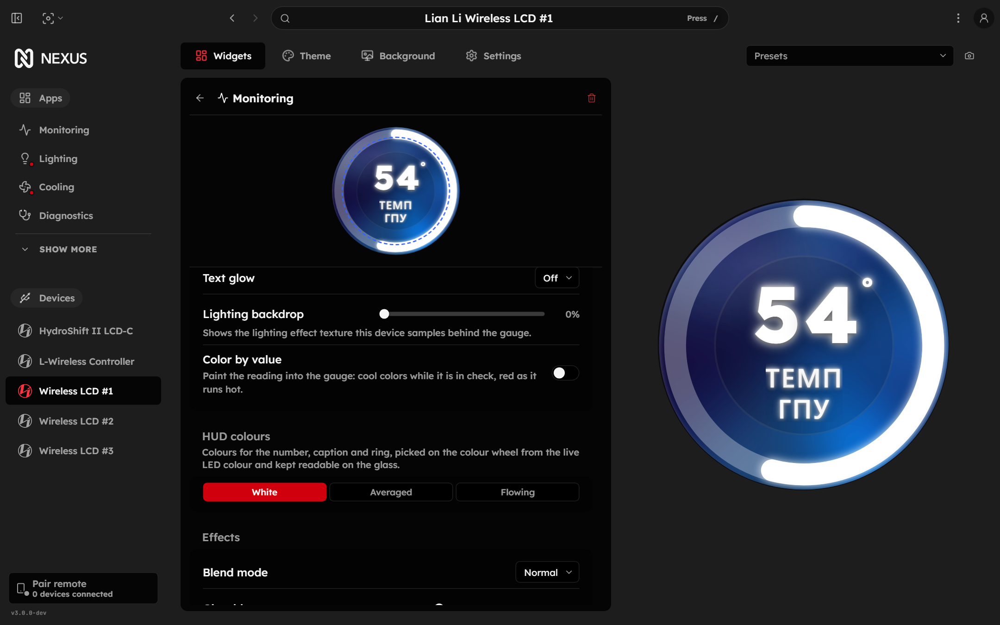
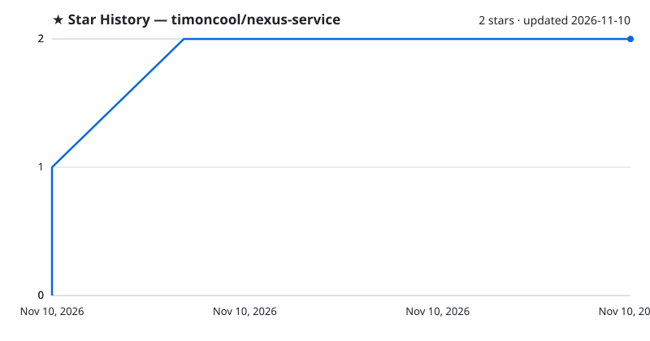

# Nexus Fast

**A Nexus build for PC lighting, screens and cooling: lower load, sturdier Lian Li wireless, screens that match their LEDs.**

**[English](README.md)** · **[Русский](README_RU.md)**

Nexus Fast is a fork of [Nexus](https://github.com/hello-nexus/nexus) (service and web UI) that cuts CPU and GPU load, makes the Lian Li wireless radio tunable, brings a hung dongle transmitter back on its own, lights fan and pump screens in the colour of their LEDs, and hands OpenRGB devices to other apps. Windows; installs over the official Nexus 3.1.9-beta.1 and rolls back with one command.

## Features

- **Lower load** — fan screens skip unchanged frames, lighting nobody reads is not rendered, radio frame rate and resends are adjustable
- **A hung dongle transmitter recovers on its own** — it is reset through the receiver, then only its own USB port is cycled, guarded against needless resets; a deaf receiver is left alone and comes back by itself, with no USB reconnects
- **Radio settings in the UI** — 2.4 GHz channel with its frequency, lighting frame rate over radio, resend budget, packet counter; the channel is saved
- **No rainbow on dropouts** — each fan's flash holds the average colour of the current effect, so a lost link looks like a frozen colour
- **Ambient Glow** — a screen design lit by its fan's own LED colour, with colour-wheel HUD colours, glass effects and blend modes
- **Webcam screen calibration** — a hue table and brightness curve measured by a camera so the glass matches the LEDs
- **Sensor rotation and layout editor** — a screen shows sensors in turn; drag, resize and rotate parts of the gauge
- **OpenRGB device hand-off** — Nexus answers the OpenRGB SDK port and gives a chosen device to another app (Aurora, SignalRGB…); each app sees only its own
- **Select-all lock** — keep a lighting card out of Select all

## Works with Aurora

Nexus Fast plays well with [Aurora](https://github.com/Aurora-RGB/Aurora) (tested on v384). From a lighting card's menu, hand the keyboard and mouse to Aurora ("Give to Aurora (RGB.NET)"). Aurora then sees and drives only those, and Nexus drives the rest: fans, pump, memory, motherboard, monitor. Nobody overwrites anybody's colours, and Aurora spends no time on devices that are not its own.

The author's Aurora desktop profile is included, cleaned up and checked — [timoncool/aurora-desktop-profile](https://github.com/timoncool/aurora-desktop-profile):
- an audio equalizer on the main block and on the numpad;
- Ctrl / Win / Alt shortcut hints;
- particles and key-press fade;
- letters blinking while Caps Lock is on;
- two-zone breathing background.

To install: close Aurora, put the file into `%APPDATA%\Aurora\Profiles\desktop\`, start Aurora and pick "Nerual Desktop" among the desktop profiles.

## Numbers

Measured on one PC (Ryzen 9 9950X3D, RTX 4090, Lian Li TL / TL LCD wireless, HydroShift II LCD-C), before and after:

| What | Before | After |
|---|---|---|
| Screens (WebView), CPU | 0.356 cores | **0.157 cores** (−56%) |
| Screens (WebView), GPU | 8.9% | **0.8%** (−91%) |
| Radio packets to the dongle at half the window rate (a setting) | 100% | **about 60%** (−40%) |
| Whole Nexus with screens, CPU | — | **1.4%** (32 threads) |

Tip: set Settings → Lighting & Cooling → Rendering device to your discrete GPU. Lighting on an RTX 4090 costs 0.34% versus 6.6% on the Ryzen integrated graphics, and the 4090 stays idle.

## Install

1. **Install the official Nexus 3.1.9-beta.1** — [hello-nexus/nexus releases](https://github.com/hello-nexus/nexus/releases/tag/v3.1.9-beta.1).
2. **Download the Nexus Fast archive** from [Releases](https://github.com/timoncool/nexus-service/releases) and unpack it.
3. **Run `install.cmd`** and accept the administrator prompt. It stops the Nexus service, keeps the original `Nexus.exe` and `wwwroot` in `C:\Program Files\Nexus\_original-<date>`, installs Nexus Fast and starts the service.

Roll back: `restore.cmd` puts the latest saved original back.

## Webcam screen calibration

LEDs are many times brighter than an LCD and render colour differently, so a screen showing "the same" colour looks off next to its fan. A camera watches the case while the lighting steps through test colours, and scripts move the screen's hue table (`slotN_glowHueLut`) and brightness curve (`slotN_glowGamma`) until the glass matches the LEDs.

| Before calibration | After |
|---|---|
|  |  |

Left: stock Nexus screens next to the lighting. Right: five test colours after calibration, the glass in tone with the LEDs.

There is no UI for it yet; these are the Python scripts one PC was calibrated with: [tools/camera-calibration](tools/camera-calibration/README.md). A UI in Nexus is planned.

## Screenshots

| Dongle radio | Device hand-off |
|---|---|
|  |  |

| Sensor rotation and layout | HUD colours and effects |
|---|---|
|  |  |

## What changed

All against Nexus of 5 November 2026 (`hello-nexus/nexus-service` `4bde382b`, `hello-nexus/nexus-web` `bbcecb392`). Code: service — [timoncool/nexus-service](https://github.com/timoncool/nexus-service/tree/lighting-accent), branch `lighting-accent`; UI — [timoncool/nexus-web](https://github.com/timoncool/nexus-web/tree/share-lighting-accent), branch `share-lighting-accent`.

**Lian Li wireless (L-Wireless)**
- 2.4 GHz channel picked in the UI (each shown with its frequency); the dongle and every bound chain move to it, and the choice survives a restart
- Lighting frame rate over radio and resend budget are settings, not constants in code
- The rolling window rate and the late-pass budget can be lowered in settings: at half the rate about 40% of the air is freed for fan control; the defaults are the original's values
- RF packet counter (System.Diagnostics.Metrics) with an on/off switch: packets a minute and peak per second on the dongle page and in the log
- Deaf receiver: only its handle is reopened, as in the original. Resetting the transmitter or cycling the receiver's port does not shorten a deaf spell and re-enumerates the dongle each time
- Hung transmitter: resets through the receiver, then its USB port is cycled; at most once in 10 minutes and 3 times a day, only with the display on and not right after sleep
- LCD video mode is armed only once the device list is known; before, the dongle could go deaf at start
- The effect's average colour (in linear light) is written to each chain's flash after an effect change; when the stream breaks the chain holds that colour instead of the firmware rainbow
- Debug: chains playing an effect Nexus did not send are logged

**Fan and pump screens**
- Ambient Glow design: the glass glows with the live colour of its fan's LEDs, no dark core and no saturation boost
- Camera calibration: colour matrix, hue table `slotN_glowHueLut`, brightness curve `slotN_glowGamma`, glow brightness and saturation
- HUD colours from colour-wheel schemes (complementary, triadic, analogous and more) checked for readability with APCA; white, averaged and flowing modes
- Glass effects (neon, ring glow, glass, vignette, bevel, emboss and more) and blend modes (screen, overlay, difference…)
- Sensor rotation in one screen (`slotN_cycle`) with a slide editor, each slide with its own settings
- Layout editor: number, unit, caption and ring are dragged, resized and rotated with the mouse
- Whole numbers, a bare degree sign, hidden units, ring inset, two-line captions
- Screens repaint only when the colour changes, at most 10 times a second; the blur runs on a quarter-size copy; unchanged frames are not sent over USB, and a still screen gets its last frame once a second so it does not sleep
- The HydroShift II panel is reopened after a ring upload instead of retrying into a silent controller

**Lighting and OpenRGB**
- OpenRGB SDK broker: Nexus listens on port 6742 and OpenRGB moves to 6741; a device can be handed to a client app (card menu "Give to …" / "Take back to Nexus", owner badge by the name) and other clients do not see it; REST `GET/PUT /devices/openrgb-owners` and MCP tools `get_device_owners` / `set_device_owner`
- Uncontrolled OpenRGB devices stay visible to other SDK clients
- The main effect is not rendered when nothing reads it (preview closed, every driven device on its own pinned look)
- Select-all lock for lighting cards
- Panel accent follows a lighting card's live colour; panel style MCP tools

## Build from source

The service is .NET 10 (AOT), the UI is Vite. Put `nexus-service` (branch `lighting-accent`) and `nexus-web` (branch `share-lighting-accent`) side by side, build the UI with `npm run build:service` and the service with `dotnet publish Nexus.Service.csproj -c Release -r win-x64`. The original build notes are in [docs/UPSTREAM_README.md](docs/UPSTREAM_README.md).

## Other Projects by [@timoncool](https://github.com/timoncool)

| Project | Description |
|---|---|
| [ScreenSavy.com](https://github.com/timoncool/ScreenSavy.com) | Ambient screen generator |
| [Bulka](https://github.com/timoncool/Bulka) | Live-coding music platform |
| [ACE-Step Studio](https://github.com/timoncool/ACE-Step-Studio) | AI music studio — songs, vocals, covers, videos |
| [VideoSOS](https://github.com/timoncool/videosos) | AI video production in the browser |
| [telegram-api-mcp](https://github.com/timoncool/telegram-api-mcp) | Full Telegram Bot API as MCP server |

## Authors

- **Nerual Dreming** — [Telegram](https://t.me/nerual_dreming) | [neuro-cartel.com](https://neuro-cartel.com) | [ArtGeneration.me](https://artgeneration.me)

## Acknowledgements

- [hello-nexus](https://github.com/hello-nexus) — Nexus itself
- [lian-li-linux](https://github.com/sgtaziz/lian-li-linux) — the Lian Li wireless protocol work
- [OpenRGB](https://gitlab.com/CalcProgrammer1/OpenRGB) — RGB device control

## Support the Author

I build open-source software and do AI research. Most of what I create is free and available to everyone. Your donations help me keep creating without worrying about where the next meal comes from =)

**[All donation methods](https://github.com/timoncool/ACE-Step-Studio/blob/master/DONATE.md)** | **[dalink.to/nerual_dreming](https://dalink.to/nerual_dreming)** | **[boosty.to/neuro_art](https://boosty.to/neuro_art)**

- **BTC:** `1E7dHL22RpyhJGVpcvKdbyZgksSYkYeEBC`
- **ETH (ERC20):** `0xb5db65adf478983186d4897ba92fe2c25c594a0c`
- **USDT (TRC20):** `TQST9Lp2TjK6FiVkn4fwfGUee7NmkxEE7C`

## Star History

<a href="https://github.com/timoncool/nexus-service/stargazers">
 <picture>
   <source media="(prefers-color-scheme: dark)" srcset="docs/stars-dark.svg" />
   <source media="(prefers-color-scheme: light)" srcset="docs/stars-light.svg" />
   
 </picture>
</a>

## License

[AGPL-3.0](LICENSE), like the original Nexus. Nexus Fast is a modified version of Nexus by hello-nexus; every change is listed above and is in the history of the `lighting-accent` and `share-lighting-accent` branches.
