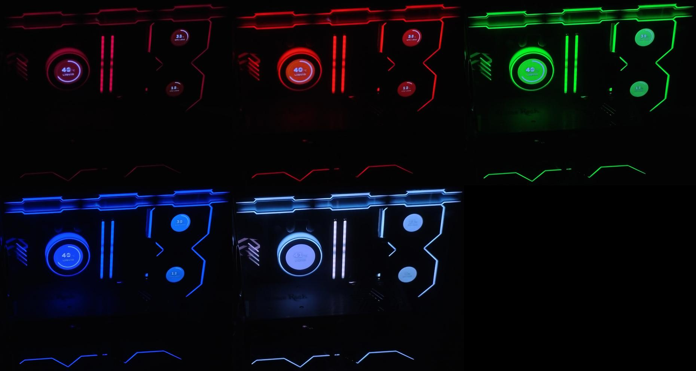
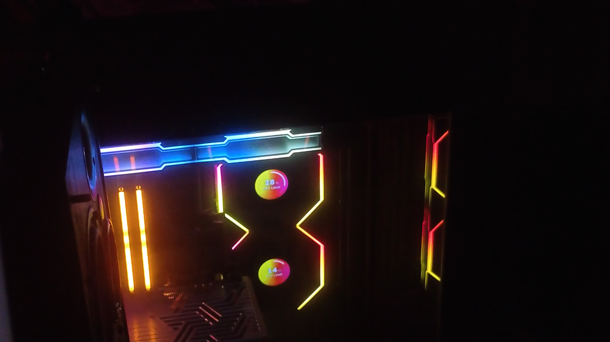
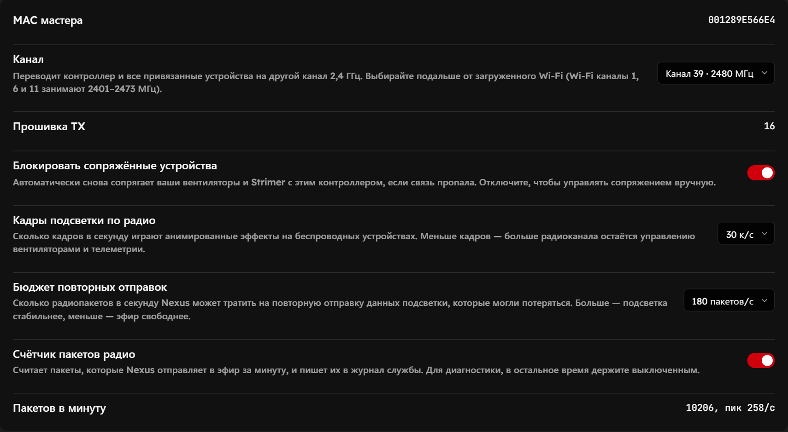
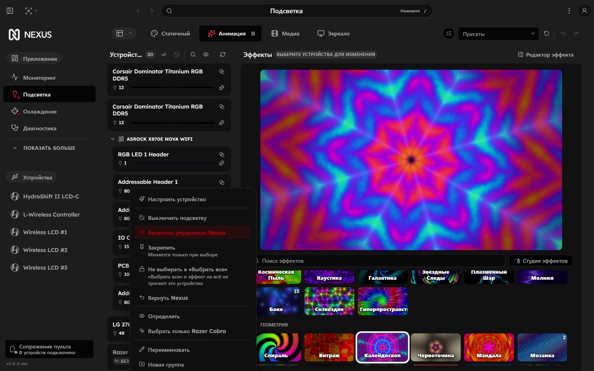
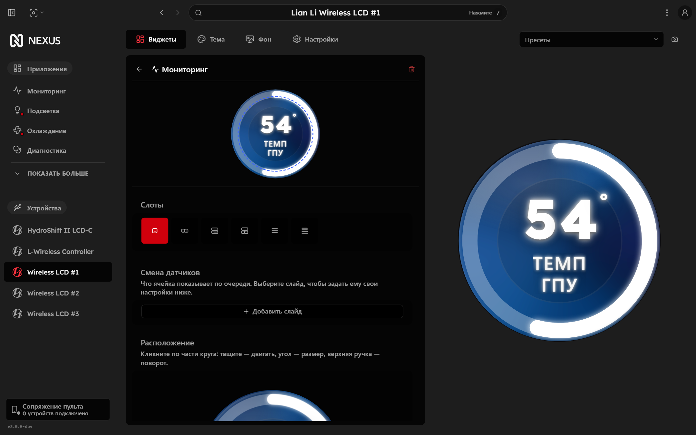
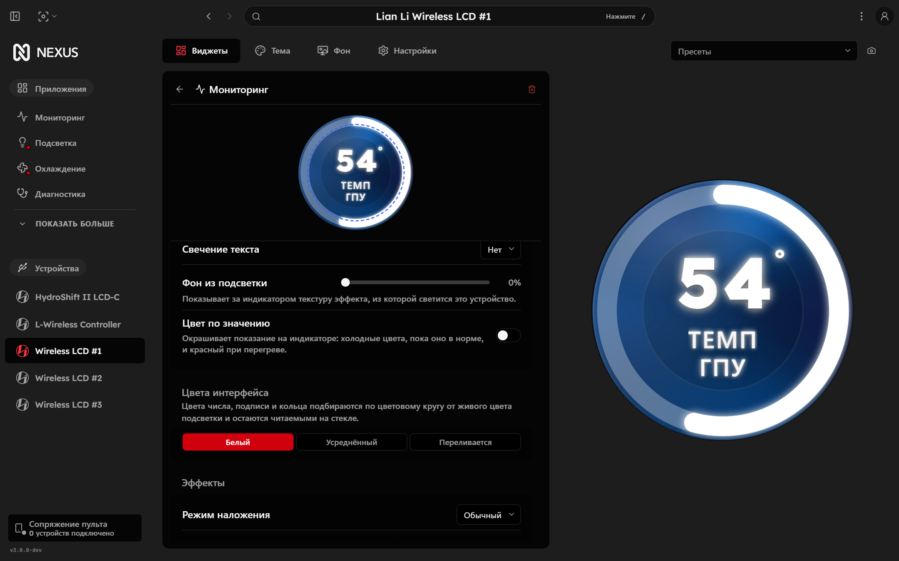
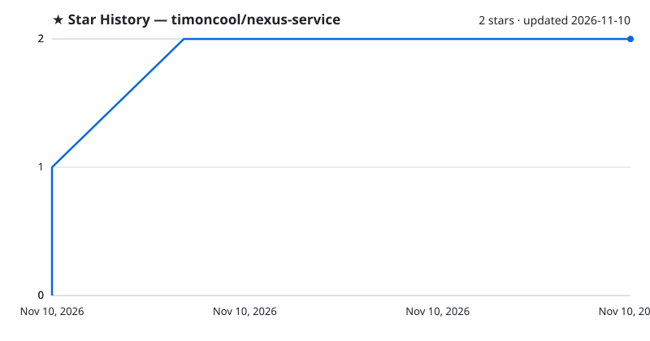

# Nexus Fast

**Сборка Nexus для подсветки, экранов и охлаждения ПК: ниже нагрузка, стабильнее беспроводные Lian Li, экраны в цвет подсветки.**

**[English](README.md)** · **[Русский](README_RU.md)**

Nexus Fast — форк [Nexus](https://github.com/hello-nexus/nexus) (служба и веб-интерфейс), в котором урезана нагрузка на процессор и видеокарту, радио беспроводных Lian Li настраивается, экраны вентиляторов и помпы светятся в цвет своей подсветки, а OpenRGB-устройства можно раздавать другим программам. Windows, ставится поверх официального Nexus 3.1.9-beta.1 и откатывается одной командой.

## Возможности

- **Меньше нагрузка** — экраны вентиляторов не перерисовываются без изменений, лишние кадры подсветки не рисуются, частота кадров и повторы по радио настраиваются
- **Радио настраивается в интерфейсе** — канал 2,4 ГГц с частотой, кадры подсветки по радио, бюджет повторных отправок, счётчик пакетов; канал сохраняется
- **Без радуги при сбоях** — во флеш каждого вентилятора пишется средний цвет текущего эффекта, обрыв связи выглядит как застывший цвет
- **Ambient Glow** — дизайн экранов, который светится цветом светодиодов своего вентилятора, с цветами HUD по цветовому кругу, эффектами стекла и режимами наложения
- **Калибровка экранов по веб-камере** — таблица оттенков и кривая яркости, снятые камерой, чтобы стекло экрана совпадало со светодиодами
- **Смена датчиков и редактор расположения** — экран показывает датчики по очереди, части круга двигаются, масштабируются и вращаются мышью
- **Раздача OpenRGB-устройств** — Nexus отвечает на порт OpenRGB SDK и отдаёт выбранное устройство другой программе (Aurora, SignalRGB…), каждая видит только своё
- **Замок от «Выбрать все»** — карточку подсветки можно исключить из массового выбора

## Работает с Aurora

Nexus Fast дружит с [Aurora](https://github.com/Aurora-RGB/Aurora) (проверено на v384). Через меню карточки подсветки клавиатура и мышь отдаются Aurora («Отдать Aurora (RGB.NET)»). Дальше Aurora видит и ведёт только их, а Nexus — всё остальное: вентиляторы, помпу, память, материнку, монитор. Никто никому не перебивает цвета, и Aurora не тратит время на чужие устройства.

Для Aurora выложен профиль рабочего стола автора — [timoncool/aurora-desktop-profile](https://github.com/timoncool/aurora-desktop-profile), вычищенный и проверенный:
- эквалайзер под звук на основном блоке и на цифровом;
- подсказки сочетаний Ctrl / Win / Alt;
- частицы и подсветка нажатий;
- мигание букв при включённом Caps Lock;
- дыхание фона двумя зонами.

Как поставить: закройте Aurora, положите файл в `%APPDATA%\Aurora\Profiles\desktop\`, запустите Aurora и выберите профиль «Nerual Desktop» в профилях рабочего стола.

## Цифры

Замеры на одном ПК (Ryzen 9 9950X3D, RTX 4090, беспроводные Lian Li TL / TL LCD, HydroShift II LCD-C), до и после правок:

| Что | Было | Стало |
|---|---|---|
| Экраны (WebView), процессор, четыре экрана | 0,356 ядра | **0,09 ядра** при ровном цвете, **0,3–0,8 ядра** при бегущем эффекте |
| Экраны (WebView), видеокарта | 8,9% | **0,8%** (−91%) |
| Пакеты по радио на донгл при половинной частоте окон (настройка) | около 240 в секунду | **около 147 в секунду** (−39%) |
| Весь Nexus вместе с экранами, процессор | — | **2–3%** (32 потока) |

Совет: в «Настройки → Подсветка и охлаждение → Устройство рендеринга» выберите дискретную видеокарту. Подсветка на RTX 4090 стоит 0,34% против 6,6% на встроенной графике Ryzen, а сама 4090 остаётся в режиме простоя.

## Установка

1. **Поставьте официальный Nexus 3.1.9-beta.1** — [hello-nexus/nexus, релизы](https://github.com/hello-nexus/nexus/releases/tag/v3.1.9-beta.1).
2. **Скачайте архив Nexus Fast** со страницы [Releases](https://github.com/timoncool/nexus-service/releases) и распакуйте.
3. **Запустите `install.cmd`** и подтвердите права администратора. Скрипт остановит службу Nexus, сохранит оригинальные `Nexus.exe` и `wwwroot` в `C:\Program Files\Nexus\_original-<дата>`, поставит Nexus Fast и запустит службу.

Откат: `restore.cmd` возвращает последнюю сохранённую копию оригинала.

## Калибровка экранов по веб-камере

Светодиоды в десятки раз ярче LCD и видят цвет иначе, поэтому экран с «тем же» цветом выглядит рядом с подсветкой чужим. Камера смотрит на корпус, подсветка проходит по тестовым цветам, а скрипты двигают таблицу оттенков экрана (`slotN_glowHueLut`) и кривую яркости (`slotN_glowGamma`), пока стекло не совпадёт со светодиодами.

| До калибровки | После |
|---|---|
|  |  |

Слева — стандартные экраны Nexus рядом с подсветкой. Справа — пять тестовых цветов после калибровки, стекло экранов в тон светодиодам.

Интерфейса для калибровки пока нет, это скрипты на Python, которыми калибровался один ПК: [tools/camera-calibration](tools/camera-calibration/README.md). Интерфейс в Nexus — в планах.

## Скриншоты

| Радио донгла | Раздача устройств |
|---|---|
|  |  |

| Смена датчиков и расположение | Цвета HUD и эффекты |
|---|---|
|  |  |

## Что изменено

Всё относительно Nexus от 5 ноября 2026 (`hello-nexus/nexus-service` `4bde382b`, `hello-nexus/nexus-web` `bbcecb392`). Код: служба — [timoncool/nexus-service](https://github.com/timoncool/nexus-service/tree/lighting-accent), ветка `lighting-accent`; интерфейс — [timoncool/nexus-web](https://github.com/timoncool/nexus-web/tree/share-lighting-accent), ветка `share-lighting-accent`.

**Беспроводные Lian Li (L-Wireless)**
- Канал 2,4 ГГц выбирается в интерфейсе (каждый показан с частотой), донгл и все привязанные цепочки переезжают на него, выбор переживает перезапуск
- Частота кадров подсветки по радио и бюджет повторных отправок — настройки, а не константы в коде
- Частоту скользящих окон подсветки и бюджет повторных проходов можно снизить в настройках: на половинной частоте освобождается около 40% эфира; по умолчанию стоят значения оригинала
- Счётчик RF-пакетов (System.Diagnostics.Metrics) с переключателем: пакеты в минуту и пик в секунду на странице донгла и в журнале
- Как подобрать частоту: включите счётчик пакетов и снижайте частоту кадров подсветки, пока в минуту не станет меньше примерно 11 000 пакетов (около 190 в секунду — столько, по замеру автора Nexus, доходит до устройств, остальное теряется). На пяти цепочках с отдельным эффектом на каждой зоне это 85 тиков вместо 53
- Оглохший приёмник: только переоткрывается, как в оригинале. Сброс передатчика и передёргивание порта приёмника глухоту не сокращают, а донгл при каждом переподключается
- Видеорежим экранов включается только после списка устройств: раньше донгл мог оглохнуть на старте
- Средний цвет эффекта (в линейном свете) пишется во флеш каждой цепочки после смены эффекта, при обрыве потока она держит этот цвет вместо заводской радуги
- Отладка: в журнал пишутся цепочки, которые играют не тот эффект, что отправил Nexus

**Экраны вентиляторов и помпы**
- Дизайн Ambient Glow: стекло светится живым цветом светодиодов своего вентилятора, без затемнения центра и подкрутки насыщенности
- Калибровка под камеру: матрица цвета, таблица оттенков `slotN_glowHueLut`, кривая яркости `slotN_glowGamma`, яркость и насыщенность свечения
- Цвета HUD по схемам цветового круга (комплементарная, триада, аналоговая и др.) с проверкой читаемости по APCA; режимы «белый», «средний», «перетекающий»
- Эффекты стекла (неон, свечение кольца, стекло, виньетка, фаска, тиснение и др.) и режимы наложения (screen, overlay, difference…)
- Смена датчиков в одном экране (`slotN_cycle`) с редактором слайдов, у каждого слайда свои настройки
- Редактор расположения: число, единица, подпись и кольцо двигаются, масштабируются и вращаются мышью
- Целые числа, градус без «C», скрытие единицы, отступ кольца от края, подписи в две строки
- Экраны перерисовываются только при смене цвета, не чаще 10 раз в секунду; размытие считается на копии в четверть размера; одинаковые кадры не отправляются в USB, неподвижный экран раз в секунду получает последний кадр, чтобы не засыпать
- Панель HydroShift II переоткрывается после загрузки кольца вместо повторов в молчащий контроллер

**Подсветка и OpenRGB**
- Брокер OpenRGB SDK: Nexus слушает порт 6742, сам OpenRGB переезжает на 6741; устройство можно отдать программе-клиенту (меню карточки «Отдать …» / «Вернуть Nexus», значок владельца у имени), остальные клиенты его не видят; REST `GET/PUT /devices/openrgb-owners` и MCP-инструменты `get_device_owners` / `set_device_owner`
- Программа-клиент остаётся на связи, когда демон OpenRGB завершается: её список устройств пустеет и наполняется снова, когда перезапущенный демон закончил опрос железа; Aurora перезапускать не нужно
- Неуправляемые OpenRGB-устройства остаются видимыми для других SDK-клиентов
- Основной эффект не рисуется, если его кадр никто не берёт (закрыто превью, у всех ведомых устройств свои закреплённые эффекты); экраны, следящие за цветом диодов, читают `/lighting/output?leds=1` — поток цветов диодов без холста
- Замок карточки от «Выбрать все»
- Акцент панели берётся из живого цвета карточки подсветки; MCP-инструменты стиля панели

## Сборка из исходников

Служба — .NET 10 (AOT), интерфейс — Vite. Положите рядом `nexus-service` (ветка `lighting-accent`), `nexus-web` (ветка `share-lighting-accent`) и оригинальный [`nexus-overlay`](https://github.com/hello-nexus/nexus-overlay) (коммит `f50a086`; это хост виджетов рабочего стола, публикация службы собирает и его). Соберите интерфейс `npm run build:service`, затем запустите `tools\publish-windows.cmd`: он поднимает окружение Visual Studio C++ и публикует службу вместе с оверлеем. Если `dotnet` в PATH старше .NET 10, сначала укажите в `NEXUS_DOTNET` папку с .NET 10 SDK. Подробности сборки оригинала — в [docs/UPSTREAM_README.md](docs/UPSTREAM_README.md).

## Другие проекты [@timoncool](https://github.com/timoncool)

| Проект | Описание |
|---|---|
| [ScreenSavy.com](https://github.com/timoncool/ScreenSavy.com) | Генератор эмбиент-экранов |
| [Bulka](https://github.com/timoncool/Bulka) | Платформа лайв-кодинга музыки |
| [ACE-Step Studio](https://github.com/timoncool/ACE-Step-Studio) | AI-студия музыки — песни, вокал, каверы, клипы |
| [VideoSOS](https://github.com/timoncool/videosos) | AI-видеопродакшн в браузере |
| [telegram-api-mcp](https://github.com/timoncool/telegram-api-mcp) | Telegram Bot API как MCP-сервер |

## Авторы

- **Nerual Dreming** — [Telegram](https://t.me/nerual_dreming) | [neuro-cartel.com](https://neuro-cartel.com) | [ArtGeneration.me](https://artgeneration.me)

## Благодарности

- [hello-nexus](https://github.com/hello-nexus) — сам Nexus
- [lian-li-linux](https://github.com/sgtaziz/lian-li-linux) — разбор протокола беспроводных Lian Li
- [OpenRGB](https://gitlab.com/CalcProgrammer1/OpenRGB) — управление RGB-устройствами

## Поддержать автора

Я создаю опенсорс софт и занимаюсь исследованиями в области ИИ. Большая часть всего, что я делаю, находится в открытом доступе. Ваши пожертвования позволяют мне создавать и исследовать больше, не отвлекаясь на поиск еды для продолжения существования =)

**[Все способы поддержки](https://github.com/timoncool/ACE-Step-Studio/blob/master/DONATE.md)** | **[dalink.to/nerual_dreming](https://dalink.to/nerual_dreming)** | **[boosty.to/neuro_art](https://boosty.to/neuro_art)**

- **BTC:** `1E7dHL22RpyhJGVpcvKdbyZgksSYkYeEBC`
- **ETH (ERC20):** `0xb5db65adf478983186d4897ba92fe2c25c594a0c`
- **USDT (TRC20):** `TQST9Lp2TjK6FiVkn4fwfGUee7NmkxEE7C`

## Star History

<a href="https://github.com/timoncool/nexus-service/stargazers">
 <picture>
   <source media="(prefers-color-scheme: dark)" srcset="docs/stars-dark.svg" />
   <source media="(prefers-color-scheme: light)" srcset="docs/stars-light.svg" />
   
 </picture>
</a>

## Лицензия

[AGPL-3.0](LICENSE), как и у оригинального Nexus. Nexus Fast — изменённая версия Nexus от hello-nexus; все изменения перечислены выше и лежат в истории веток `lighting-accent` и `share-lighting-accent`.
