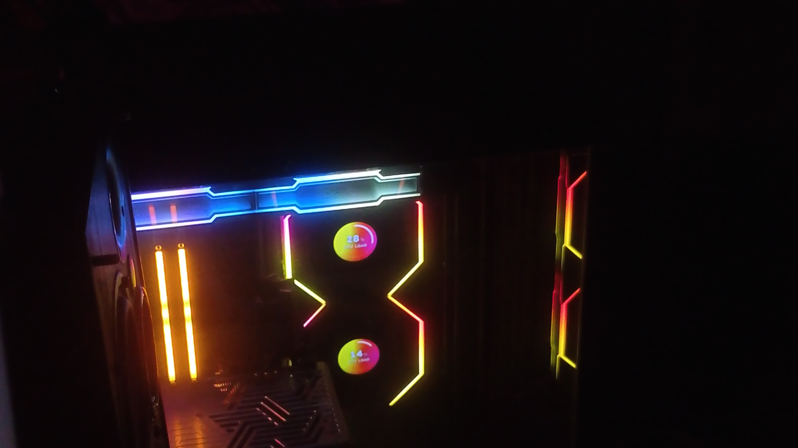
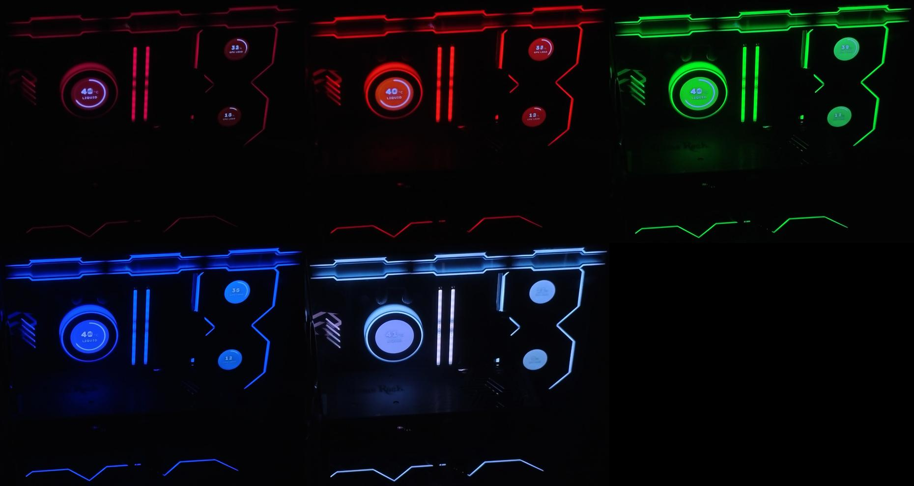

# Калибровка экранов по веб-камере / Webcam screen calibration

**[Русский](#русский)** · **[English](#english)**

## Русский

Скрипты, которыми калибровались экраны вентиляторов и помпы одного ПК (три Lian Li TL LCD Wireless и HydroShift II LCD-C) под их собственную подсветку. Интерфейса нет, это рабочие скрипты как есть: id устройств, id экранов и координаты зон в кадре в них вписаны под тот ПК и правятся под свой.

| До | После |
|---|---|
|  |  |

### Как это работает

Экран в дизайне Ambient Glow светится цветом светодиодов своего вентилятора. Но светодиод и LCD передают один и тот же цвет по-разному, и камера (как и глаз) видит их разными. Калибровка подбирает поправки, которые Nexus Fast применяет к стеклу экрана:

- `slotN_glowHueLut` — таблица оттенков: узлы `вход:выход` в градусах, по ним экран сдвигает оттенок;
- `slotN_glowGamma` — кривая яркости, чтобы стекло держало ту же долю света кольца на любой яркости;
- матрица цвета — общая поправка цвета экрана.

Поправки пишутся в настройки экрана через MCP-инструмент Nexus `set_panel_style`, поэтому после калибровки камера больше не нужна.

### Что нужно

- Nexus Fast, экраны в дизайне Ambient Glow;
- веб-камера, которая видит экраны и подсветку в одном кадре, с ручной экспозицией;
- Python 3.11 и `numpy`, `pillow`, `scipy`;
- ffmpeg — подойдёт тот, что лежит в `C:\Program Files\Nexus\tools\ffmpeg`;
- включённая в Nexus интеграция с ИИ (MCP): `mcpc.py` берёт её токен из `C:\ProgramData\Nexus\settings.json`.

### Порядок

1. **Камера пишет кадры.** Поток с камеры должен обновлять `latest.jpg` рядом со скриптами, например:
   ```bat
   "C:\Program Files\Nexus\tools\ffmpeg\ffmpeg.exe" -f dshow -vcodec h264 -video_size 3840x2160 -i video="<имя камеры>" -r 3 -update 1 -q:v 3 -y latest.jpg
   ```
   `calibrate_screens.py` запускает такой поток сам.
2. **Зоны в кадре.** В `rois.py` впишите центры и радиусы экранов (`SCREENS`, ключ — id экрана Nexus) и зоны светодиодов (`LED_BOXES`); в остальных скриптах — id своих устройств подсветки и экранов (константы в начале файлов).
3. **Замеры.** `measure2.py leds` и `measure2.py screen` (или `measure_screen.py`) прогоняют тестовые цвета и пишут, как камера видит светодиоды и экраны (`pass_leds.json`, `pass_screen.json`).
4. **Таблица оттенков.** `cal2.py` — для каждого экрана и цвета свой узел таблицы; `loop.py` — замкнутый цикл: камера сравнивает экран со светодиодами и подвигает таблицу, пока ошибка не станет меньше порога; `refine.py` и `node345.py` — точная подгонка отдельных узлов.
5. **Яркость помпы.** `gamma.py` подбирает `slotN_glowGamma`, чтобы стекло помпы держало долю света кольца на всех яркостях; `bright.py` и `match.py` — помощники к нему.
6. **Матрица цвета.** `calibrate_screens.py` — замер экранов против светодиодов и подбор общей поправки цвета.

Скрипты на время замера меняют закреплённые цвета подсветки и возвращают исходные в конце.

## English

The scripts one PC's fan and pump screens (three Lian Li TL LCD Wireless and a HydroShift II LCD-C) were calibrated with against their own lighting. There is no UI; these are working scripts as they are: device ids, screen ids and frame regions are written in for that PC and need editing for yours.

How it works: an Ambient Glow screen glows with its fan's LED colour, but an LED and an LCD render the same colour differently. Calibration finds the corrections Nexus Fast applies to the glass — the hue table `slotN_glowHueLut` (`in:out` nodes in degrees), the brightness curve `slotN_glowGamma`, and a colour matrix — and writes them to the screen through the Nexus MCP tool `set_panel_style`, so the camera is not needed afterwards.

Needs: Nexus Fast with Ambient Glow screens; a webcam that sees screens and LEDs in one frame, with manual exposure; Python 3.11 with `numpy`, `pillow`, `scipy`; ffmpeg (the one in `C:\Program Files\Nexus\tools\ffmpeg` works); Nexus AI integration (MCP) enabled — `mcpc.py` reads its token from `C:\ProgramData\Nexus\settings.json`.

Order: keep `latest.jpg` updated from the camera (command above); set screen and LED regions in `rois.py` and your device and screen ids at the top of the scripts; measure with `measure2.py leds` / `measure2.py screen`; build the hue table with `cal2.py`, close the loop with `loop.py`, fine-tune nodes with `refine.py` / `node345.py`; fit the pump brightness curve with `gamma.py`; fit the colour matrix with `calibrate_screens.py`. The scripts change pinned lighting colours while measuring and restore them at the end.
